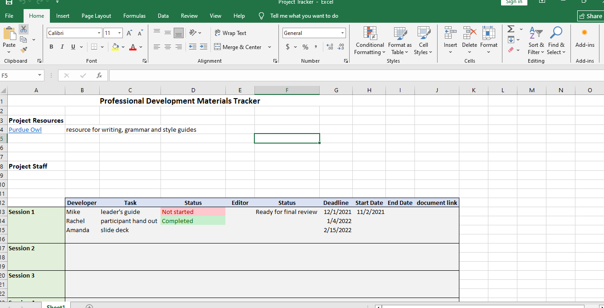

# Excel Project Tracker | Task Management

## Project Overview

This project demonstrates how to build a practical Project Tracker using Microsoft Excel.

The tracker helps organize project resources, assign responsibilities, monitor task progress, and manage deadlines across multiple project sessions.

## Key Features

- Project resource management.
- Developer and staff assignment.
- Task tracking across five project sessions.
- Task status and review status monitoring.
- Due date, start date, and end date tracking.
- Dropdown lists for consistent data entry.
- Conditional formatting for visual status identification.
- Document link management.

## Dashboard Preview

## Tools & Excel Skills

- Microsoft Excel
- Data Validation
- Dropdown Lists
- Conditional Formatting
- Spreadsheet Design
- Task and Deadline Management

## Project File

[Download the Excel Project Tracker](Project%20Tracker.xlsx)

## Project Objective

The objective of this project is to demonstrate the ability to design a structured and user-friendly Excel tracker that helps teams organize project activities and monitor task progress efficiently.
